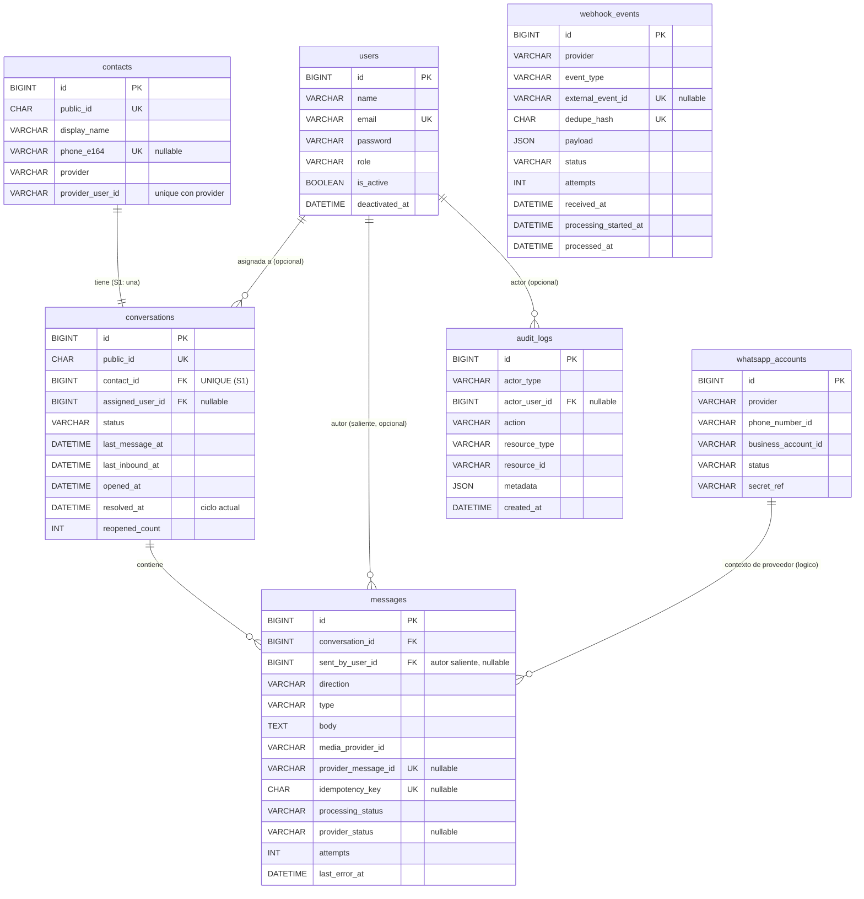

# Modelo de datos — MVP de Positive

> **Estado (2026-10-10):** implementado como esquema y modelos en Tarea 03. Migraciones en
> `backend/database/migrations`, modelos en `backend/app/Models`, pruebas en `backend/tests/Feature/Database`.
> Para decisiones aún sin aprobar, ver
> [`design-decisions-pending.md`](design-decisions-pending.md). Para transiciones de estado, ver
> [`state-machines.md`](state-machines.md). Para permisos, ver [`../security/permission-matrix.md`](../security/permission-matrix.md).

## 1. Propósito y alcance

Definir las entidades, relaciones, restricciones, índices y reglas de conservación que el MVP necesita
para soportar los escenarios funcionales de la sección 2, **sin** implementarlos aún.

Alcance: **una empresa, un número empresarial, 3–10 empleados, roles `admin`/`agent`**.
Fuera de alcance: multitenencia completa, microservicios, infraestructura distribuida.

La integración real con WhatsApp está **bloqueada** (ver [`../integrations/meta-integration-pending.md`](../integrations/meta-integration-pending.md)).
El modelo se diseña para un adaptador desacoplado y un adaptador **simulado** durante el desarrollo.

## 2. Escenarios funcionales mínimos

El modelo se deriva de estos escenarios, no de una lista fija de tablas.

| # | Escenario | Entidades implicadas |
|---|---|---|
| 1 | Un administrador crea o desactiva un usuario. | `users`, `audit_logs` |
| 2 | Un agente inicia sesión y consulta las conversaciones a las que tiene acceso. | `users`, `conversations` |
| 3 | Una conversación se crea o se asocia a un contacto. | `contacts`, `conversations` |
| 4 | Un administrador o agente autorizado asigna una conversación. | `conversations`, `audit_logs` |
| 5 | Un agente autorizado consulta el historial y cambia el estado de una conversación. | `messages`, `conversations`, `audit_logs` |
| 6 | Un agente intenta enviar un mensaje. | `messages`, `users` |
| 7 | El sistema registra el resultado conocido del envío. | `messages`, `whatsapp_accounts` |
| 8 | Se recibe un evento externo que actualiza el estado de un mensaje. | `webhook_events`, `messages` |
| 9 | El mismo evento se recibe más de una vez. | `webhook_events` |
| 10 | Se recibe un evento fuera de orden. | `webhook_events`, `messages` |
| 11 | Un envío termina en error temporal, permanente o incierto. | `messages` |
| 12 | Dos empleados intentan modificar o atender la misma conversación simultáneamente. | `conversations`, `audit_logs` |

### Supuestos documentados

- **S1 — Una conversación por contacto.** Se eligió reabrir la misma conversación. `conversations.contact_id`
  es **único**. Esto **bloquea** la segmentación por hilos en el futuro sin una migración; se acepta por simplicidad.
- **S2 — Identidad de contacto no es solo el teléfono.** WhatsApp puede entregar identificadores de usuario
  (BSUID/usernames) donde el número no está presente. `phone_e164` es **opcional** y la identidad se compone de
  `provider` + `provider_user_id` o `phone_e164`. Ver [DD-009](design-decisions-pending.md#dd-009).
- **S3 — Mono-empresa sin tabla de empresas.** No se crea `companies`/`tenant_id`. Se documenta dónde se
  introduciría el aislamiento futuro. Ver [DD-004](design-decisions-pending.md#dd-004).
- **S4 — UTC.** Todas las fechas se almacenan en UTC y se presentan en hora local en el cliente.
- **S5 — `pending` es operativo, no técnico.** Ver [`state-machines.md`](state-machines.md); provisional.
- **S6 — Media diferido.** No se almacenan binarios; solo se guarda el identificador de media del proveedor.
  Ver [DD-006](design-decisions-pending.md#dd-006).
- **S7 — Secretos fuera de la base de datos.** Solo se guarda una **referencia** (`secret_ref`), nunca el valor.

## 3. Convenciones

- **Motor/charset:** InnoDB, `utf8mb4` / `utf8mb4_0900_ai_ci` (MySQL 8.4 LTS).
- **Claves primarias:** `BIGINT UNSIGNED` autoincremental (`id`). Eficiente para FK e índices.
- **Identificador público:** `public_id` `CHAR(26)` ULID con índice único en los recursos referenciados por
  URL (`contacts`, `conversations`) y en `users` (T09, para `assigned_user.public_id` y el destino de
  asignación). Los `messages` se acceden siempre bajo una conversación autorizada y usan su `id` interno.
  Ver [DD-008](design-decisions-pending.md#dd-008) y [ADR-008](../decisions/ADR-008-internal-write-operations.md).
- **Fechas:** `DATETIME` en UTC (no `TIMESTAMP`, para no depender de la zona horaria de sesión de MySQL).
  Aplicado en las tablas creadas en Tarea 03; la tabla `users` base conserva el `timestamp` del scaffold de
  Laravel (divergencia registrada; alinear solo si se aprueba).
- **Enumeraciones:** `VARCHAR` con validación en aplicación (no `ENUM` de MySQL), para poder añadir valores sin
  migración. Los valores válidos se documentan en [`state-machines.md`](state-machines.md).
- **Nombres:** tablas en plural `snake_case`; FK `<entidad>_id`; timestamps `created_at`/`updated_at` (Laravel/Eloquent).
- **Borrado:** por defecto **sin borrado** de historial ni auditoría. Las FK usan `RESTRICT` o `NULL` según el caso;
  **no** `ON DELETE CASCADE` sobre historial. Ver §6.
- **Timestamps:** `created_at`/`updated_at` en tablas mutables; `audit_logs` es append-only (solo `created_at`).

## 4. Entidades

Se evalúan las siete entidades propuestas. Se **adoptan seis** y se **rechaza** `whatsapp_accounts` como tabla
completa, reduciéndola a una tabla mínima justificada (§4.6). No se añaden entidades nuevas.

### 4.1 `users`

- **Responsabilidad:** empleados y administradores; identidad para autenticación y autorización.
- **Adopción:** necesaria; ninguna otra entidad puede representar al actor.
- **Atributos:**

  | Columna | Tipo | Nulo | Notas |
  |---|---|---|---|
  | `id` | `BIGINT UNSIGNED` | no | PK; FK interna (no pública) |
  | `public_id` | `CHAR(26)` | no | ULID; único; identidad pública (T09) |
  | `name` | `VARCHAR(255)` | no | Nombre para mostrar |
  | `email` | `VARCHAR(255)` | no | Único; login |
  | `password` | `VARCHAR(255)` | no | Hash (Laravel; nunca texto plano) |
  | `role` | `VARCHAR(20)` | no | `admin` \| `agent` (validado en app) |
  | `is_active` | `TINYINT(1)` | no | Default `1` |
  | `deactivated_at` | `DATETIME` | sí | Marca de desactivación (UTC) |
  | `created_at`/`updated_at` | `DATETIME` | no | Laravel |

- **PK:** `id`. **Unicidad:** `email` (unique); `public_id` (unique).
- **Compatibilidad con Laravel:** se parte de la migración `users` existente y se **añaden** `role`, `is_active`,
  `deactivated_at` (aplicado en la migración `2026_10_10_000001`) y `public_id` (T09, migración
  `2026_10_19_000001`, con backfill de filas existentes); se **eliminó** `email_verified_at` (panel
  interno, sin flujo de verificación). `remember_token` se **conserva**; prescindir de él depende del modelo de
  autenticación aprobado (DD-013). Cambios de esquema en tarea de migraciones.
- **Índices:** `email` (unique); `public_id` (unique). No se requieren más.
- **Uso externo:** `users.id` sigue siendo la FK interna en `conversations`, `messages` y `audit_logs`; los
  contratos públicos usan `users.public_id` para `assigned_user.public_id` y el destino de asignación.
- **Conservación:** **no se borra**; desactivar es `is_active=0` + `deactivated_at`.
- **Riesgos de integridad/concurrencia:** desactivar a un usuario con conversaciones asignadas debe resolverse en
  transacción (§6, §D de permisos). Evitar email reutilizado por baja: no se reutiliza (no se borra).

### 4.2 `contacts`

- **Responsabilidad:** contener los datos mínimos de los interlocutores de WhatsApp.
- **Adopción:** necesaria; se separa de `conversations` porque un contacto persiste con independencia del hilo.
- **Atributos:**

  | Columna | Tipo | Nulo | Notas |
  |---|---|---|---|
  | `id` | `BIGINT UNSIGNED` | no | PK |
  | `public_id` | `CHAR(26)` | no | ULID; único; clave de URL |
  | `display_name` | `VARCHAR(255)` | sí | Nombre; mínimo necesario |
  | `phone_e164` | `VARCHAR(16)` | sí | Normalizado E.164; único cuando no nulo |
  | `provider` | `VARCHAR(30)` | sí | p. ej. `meta` |
  | `provider_user_id` | `VARCHAR(64)` | sí | WA ID / BSUID recibido |
  | `created_at`/`updated_at` | `DATETIME` | no | Laravel |

- **PK:** `id`. **Unicidad:** `public_id`; `phone_e164`; `(provider, provider_user_id)`.
- **CHECK:** `phone_e164 IS NOT NULL OR provider_user_id IS NOT NULL` (al menos una identidad). Implementado
  como restricción de base de datos **solo en MySQL** (`contacts_identity_check`); SQLite no soporta
  `ALTER TABLE ... ADD CHECK`, por lo que en las pruebas SQLite la regla se ejercita como validación de
  aplicación (pendiente) y el test correspondiente queda marcado como `skipped`.
- **Índices:** `public_id` (unique), `phone_e164` (unique), `(provider, provider_user_id)` (unique). La búsqueda
  por teléfono usa el índice único; búsquedas por sufijo no son indexables (se documenta y se limita).
- **Conservación:** **no se borra** mientras existan conversaciones. Política de retención/anonimización pendiente
  ([DD-005](design-decisions-pending.md#dd-005)). No se usa `CASCADE`.
- **Riesgos de integridad/concurrencia:** deduplicación de entrantes concurrentes del mismo contacto → crear o
  recuperar con **upsert/lock** sobre la identidad; si no hay identificador estable, **crear y marcar para revisión**
  (nunca fusionar por nombre).

### 4.3 `conversations`

- **Responsabilidad:** representar el hilo operativo entre el número y un contacto, con su estado y responsable.
- **Adopción:** necesaria; agrupa mensajes y el ciclo de atención.
- **Atributos:**

  | Columna | Tipo | Nulo | Notas |
  |---|---|---|---|
  | `id` | `BIGINT UNSIGNED` | no | PK |
  | `public_id` | `CHAR(26)` | no | ULID; único; clave de URL |
  | `contact_id` | `BIGINT UNSIGNED` | no | FK → `contacts.id`; **UNIQUE** (S1) |
  | `assigned_user_id` | `BIGINT UNSIGNED` | sí | FK → `users.id`; responsable |
  | `status` | `VARCHAR(20)` | no | `open` \| `pending` \| `resolved`; default `open` |
  | `last_message_at` | `DATETIME` | sí | UTC; orden de listado |
  | `last_inbound_at` | `DATETIME` | sí | UTC; base para «no leído»/SLA futura |
  | `opened_at` | `DATETIME` | no | Inicio del ciclo actual (UTC) |
  | `resolved_at` | `DATETIME` | sí | Ciclo actual; se anula al reabrir |
  | `reopened_count` | `INT UNSIGNED` | no | Default `0` |
  | `created_at`/`updated_at` | `DATETIME` | no | Laravel |

- **PK:** `id`. **Unicidad:** `public_id`; `contact_id`.
- **FK:** `contact_id` → `contacts.id` `ON DELETE RESTRICT`; `assigned_user_id` → `users.id` `ON DELETE SET NULL`.
- **Índices:** `(status, last_message_at)` (listado por estado ordenado por actividad);
  `(assigned_user_id, status, last_message_at)`. Documentado: la consulta «propias **o** sin asignar» requiere dos
  ramas/`UNION`, porque un índice no sirve bien un `OR` con `IS NULL` (ver §5).
- **Conservación:** **no se borra**; conserva historial. Una conversación por contacto (S1).
- **Riesgos de integridad/concurrencia:**
  - Creación concurrente para un mismo contacto: `UNIQUE(contact_id)` + creación con lock/`upsert`.
  - *Claim* y reasignación: **update condicional** en transacción (`WHERE assigned_user_id IS NULL` para tomar;
    comparación del responsable actual para reasignar) y **auditoría**; ver §6.
  - `last_message_at` se actualiza en la **misma transacción** que el mensaje, sin retroceder (usar `MAX`/condición).
  - Reapertura **manual** (`resolved → open`, T09): anula `resolved_at` y **no** modifica `reopened_count`. La
    reapertura automática por actividad entrante (futura) incrementará `reopened_count`; el historial de ciclos
    vive en `audit_logs` (§[state-machines](state-machines.md)). Tabla dedicada de transiciones **diferida**.

### 4.4 `messages`

- **Responsabilidad:** registrar mensajes entrantes y salientes con **dos ejes de estado separados**:
  procesamiento interno y estado de transporte del proveedor.
- **Adopción:** necesaria; no puede derivarse de `conversations`.
- **Atributos:**

  | Columna | Tipo | Nulo | Notas |
  |---|---|---|---|
  | `id` | `BIGINT UNSIGNED` | no | PK; orden cronológico por conversación |
  | `conversation_id` | `BIGINT UNSIGNED` | no | FK → `conversations.id` |
  | `sent_by_user_id` | `BIGINT UNSIGNED` | sí | FK → `users.id`; responsable que envía un saliente; `NULL` en entrantes o automatización |
  | `direction` | `VARCHAR(10)` | no | `inbound` \| `outbound` |
  | `type` | `VARCHAR(20)` | no | `text`, `image`, `audio`, `video`, `document`, `sticker`, `location`, `contacts`, `template`, `system`, `unknown` |
  | `body` | `TEXT` | sí | Texto/caption; puede ser nulo (p. ej. multimedia sin texto) |
  | `media_provider_id` | `VARCHAR(255)` | sí | Id de media del proveedor; **no** el binario (S6) |
  | `provider_message_id` | `VARCHAR(255)` | sí | Id externo (p. ej. `wamid`); único cuando existe |
  | `idempotency_key` | `CHAR(36)` | sí | UUID; único; clave de envío saliente idempotente |
  | `processing_status` | `VARCHAR(20)` | no | Estado interno (ver máquina de estados) |
  | `provider_status` | `VARCHAR(20)` | sí | Transporte (solo saliente) |
  | `error_code` | `VARCHAR(64)` | sí | Código normalizado del error |
  | `error_message` | `TEXT` | sí | Mensaje saneado; sin secretos |
  | `attempts` | `INT UNSIGNED` | no | Default `0` |
  | `last_error_at` | `DATETIME` | sí | UTC |
  | `provider_timestamp` | `DATETIME` | sí | Marca del proveedor (UTC) |
  | `provider_status_at` | `DATETIME` | sí | Cuándo se observó el último `provider_status` (UTC) |
  | `created_at`/`updated_at` | `DATETIME` | no | Laravel |

- **PK:** `id`. **Unicidad:** `provider_message_id` (cuando no nulo); `idempotency_key` (cuando no nulo).
- **FK:** `conversation_id` → `conversations.id` `ON DELETE RESTRICT`;
  `sent_by_user_id` → `users.id` `ON DELETE SET NULL` (autor del saliente; `NULL` si sistema/automatización).
- **Índices:** `(conversation_id, id)` para **keyset pagination** del historial; únicos de arriba para dedupe/idempotencia.
  Índice operativo por `(processing_status, last_error_at)` para reintentos/atascos.
- **Conservación:** **no se borra** por acción de usuario; retención por política ([DD-005](design-decisions-pending.md#dd-005)).
- **Riesgos de integridad/concurrencia:**
  - **No se mezclan** `processing_status` y `provider_status` (evita asumir una única secuencia).
  - `provider_status` **monótono**: no retrocede (`delivered` nunca vuelve a `sent`); eventos fuera de orden se
    descartan si no avanzan.
  - Reintento de envío idempotente por `idempotency_key`; **un resultado incierto no se reenvía a ciegas**
    (puede duplicar en WhatsApp; ver [`state-machines.md`](state-machines.md)).

### 4.5 `whatsapp_accounts` (evaluación y reducción)

- **Responsabilidad:** metadatos **no secretos** de la conexión y del número, para la administración de la
  configuración de la integración (capacidad de la matriz de permisos) y para futuros múltiples números.
- **¿Por qué no basta una entidad existente?** Ninguna otra entidad representa la cuenta/número.
- **¿Por qué tabla y no solo configuración?** La matriz exige que `admin` **administre** la configuración de la
  integración; editar `phone_number_id`/estado no debería requerir redeplegar. **Limitación:** con un único número
  es casi una fila; se acepta como decisión documentada ([DD-010](design-decisions-pending.md#dd-010)).
- **Atributos:**

  | Columna | Tipo | Nulo | Notas |
  |---|---|---|---|
  | `id` | `BIGINT UNSIGNED` | no | PK |
  | `provider` | `VARCHAR(30)` | no | p. ej. `meta` |
  | `display_number` | `VARCHAR(32)` | sí | Número mostrado (no es la identidad técnica) |
  | `phone_number_id` | `VARCHAR(64)` | sí | Id del número (no secreto) |
  | `business_account_id` | `VARCHAR(64)` | sí | Id de cuenta (no secreto) |
  | `status` | `VARCHAR(20)` | no | `unconfigured` \| `configured` \| `disabled` |
  | `secret_ref` | `VARCHAR(255)` | sí | **Referencia** al gestor de secretos; nunca el valor (S7) |
  | `created_at`/`updated_at` | `DATETIME` | no | Laravel |

- **PK:** `id`. **Unicidad:** `(provider, phone_number_id)` cuando no nulo.
- **Conservación:** no se borra si tiene historial asociado; se deshabilita con `status`.
- **Riesgos:** **nunca** almacenar tokens/servidores en claro; rotación y acceso vía gestor de secretos
  ([DD-007](design-decisions-pending.md#dd-007)).

### 4.6 `webhook_events`

- **Responsabilidad:** registrar la recepción de eventos externos, su estado de procesamiento y su resultado,
  permitiendo deduplicación, reintento y diagnóstico.
- **Adopción:** necesaria; desacopla la recepción (rápida, verificable) del procesamiento (con efectos de negocio).
- **Atributos:**

  | Columna | Tipo | Nulo | Notas |
  |---|---|---|---|
  | `id` | `BIGINT UNSIGNED` | no | PK |
  | `provider` | `VARCHAR(30)` | no | p. ej. `meta` |
  | `event_type` | `VARCHAR(50)` | no | Tipo lógico del evento |
  | `external_event_id` | `VARCHAR(128)` | sí | Único cuando el proveedor lo entrega |
  | `dedupe_hash` | `CHAR(64)` | no | Hash canónico (ver abajo); único |
  | `payload` | `JSON` | no | Cuerpo recibido (posible PII; retención [DD-005](design-decisions-pending.md#dd-005)) |
  | `status` | `VARCHAR(20)` | no | `received` \| `processing` \| `processed` \| `failed` \| `ignored` |
  | `attempts` | `INT UNSIGNED` | no | Default `0` |
  | `last_error` | `TEXT` | sí | Saneado; sin secretos |
  | `received_at` | `DATETIME` | no | UTC |
  | `processing_started_at` | `DATETIME` | sí | UTC; detección de atascos |
  | `processed_at` | `DATETIME` | sí | UTC |

- **PK:** `id`. **Unicidad:** `external_event_id` (cuando no nulo); `dedupe_hash`.
- **Índices:** `(status, received_at)` para recuperar pendientes/fallidos; únicos de arriba.
- **Regla de deduplicación (canónica):**
  1. Si el proveedor entrega un **id de evento fiable**, deduplicar por `external_event_id`.
  2. Si no, calcular `dedupe_hash = SHA-256` de un **subconjunto estable y ordenado** (provider + event_type +
     identidad del mensaje + tipo de estado + marca temporal relevante), **no** del payload completo.
- **Limitaciones (documentadas):** puede haber falsos positivos/negativos; por eso los **efectos de negocio son
  idempotentes** y no dependen solo del hash. La idempotencia del proveedor no está garantizada mientras Meta no
  esté validado ([DD-011](design-decisions-pending.md#dd-011)).
- **Conservación:** purga del `payload` tras la retención definida; el registro de estado se conserva para auditoría.

### 4.7 `audit_logs`

- **Responsabilidad:** registrar acciones sensibles de usuarios y del sistema. **Append-only.**
- **Adopción:** necesaria (requisito de registro de acciones). Es también la fuente de historial de transiciones
  de estado de las conversaciones.
- **Atributos:**

  | Columna | Tipo | Nulo | Notas |
  |---|---|---|---|
  | `id` | `BIGINT UNSIGNED` | no | PK |
  | `actor_type` | `VARCHAR(10)` | no | `user` \| `system` |
  | `actor_user_id` | `BIGINT UNSIGNED` | sí | FK → `users.id`; nulo si `system` |
  | `action` | `VARCHAR(64)` | no | p. ej. `conversation.status_changed` |
  | `resource_type` | `VARCHAR(40)` | no | p. ej. `conversation` |
  | `resource_id` | `VARCHAR(40)` | sí | Id del recurso afectado |
  | `metadata` | `JSON` | sí | Contexto mínimo (p. ej. `{from,to}`); **sin secretos ni contenido de mensajes** |
  | `ip_address` | `VARCHAR(45)` | sí | Dirección (IPv4/IPv6) del actor, si aplica |
  | `created_at` | `DATETIME` | no | UTC; inmutable |

- **PK:** `id`. **FK:** `actor_user_id` → `users.id` `ON DELETE SET NULL` (conserva la traza).
- **Índices:** `(resource_type, resource_id, created_at)`; `(actor_user_id, created_at)`; `(action, created_at)`.
- **Conservación:** **no se actualiza ni se borra** desde la aplicación; retención amplia por política
  ([DD-005](design-decisions-pending.md#dd-005)). Sin `updated_at`.

## 5. Consultas críticas e índices

| Consulta del MVP | Acceso | Índice que la sirve |
|---|---|---|
| Listado paginado de conversaciones por estado, orden por actividad | `status = ? ORDER BY last_message_at` | `(status, last_message_at)` |
| «Mis conversaciones» | `assigned_user_id = ? AND status = ?` | `(assigned_user_id, status, last_message_at)` |
| «Sin asignar» | `assigned_user_id IS NULL` | índice anterior (rama `IS NULL`); **se documenta** que «propias **o** sin asignar» se resuelve con dos consultas/`UNION` |
| Historial de mensajes (más recientes primero) | `conversation_id = ? ORDER BY id DESC` | `(conversation_id, id)` (keyset; el índice sirve también el recorrido inverso) |
| Búsqueda de contactos por teléfono | `phone_e164 = ?` | único `phone_e164` |
| Recuperar eventos pendientes/fallidos | `status IN (...) ORDER BY received_at` | `(status, received_at)` |
| Mensajes a reintentar / atascados | `processing_status = ? ORDER BY last_error_at` | `(processing_status, last_error_at)` |
| Trazas de un recurso | `resource_type = ? AND resource_id = ?` | `(resource_type, resource_id, created_at)` |

- **Nota (DD-001, 2026-10-12):** en el MVP la **visibilidad de lectura es total** para los roles operativos
  (`admin` y `agent`); las consultas «Mis conversaciones» y «Sin asignar» de la tabla justifican índices y describen
  patrones de consulta futuros (filtrado por responsable), **no** la política de visibilidad vigente. Ver
  [permission-matrix §3](../security/permission-matrix.md#3-política-de-visibilidad-de-conversaciones-mvp).
- **Paginación:** **keyset/cursor** (no `OFFSET`) en historial de mensajes y en listados grandes.
- **No se añaden** índices «por si acaso»; cada índice responde a una consulta real de la tabla. En el volumen del
  MVP (3–10 usuarios, un número) el impacto de escritura es despreciable, pero se evita redundancia.

## 6. Integridad y concurrencia

- **Relaciones:** `contacts 1—N conversations` (con `UNIQUE(contact_id)`, hoy es `1—1`), `conversations 1—N messages`,
  `users 1—N conversations` (responsable, nullable), `users 1—N messages` (autor del saliente, nullable),
  `users 1—N audit_logs`. FKs con `RESTRICT` en historial; `SET NULL` en responsables/actores.
- **Unicidad de identificadores externos:** `messages.provider_message_id`, `contacts.(provider,provider_user_id)`,
  `webhook_events.external_event_id` — únicos **solo cuando existen** (se admiten múltiples `NULL`).
- **Conservación del historial:** **sin borrados en cascada** sobre `conversations`, `messages` ni `audit_logs`.
  El borrado/anonimización solo por política de retención explícita ([DD-005](design-decisions-pending.md#dd-005)).
- **Asignaciones válidas:** `assigned_user_id` debe referenciar un usuario **activo** (validado en aplicación);
  asignar a inactivo se rechaza con `422` (T09). Al desactivar un usuario, sus conversaciones se dejan **sin
  asignar** en la misma transacción + auditoría (provisional; el flujo de desactivación no forma parte de T09,
  ver [`../security/permission-matrix.md`](../security/permission-matrix.md)).
- **Claim concurrente:** tomar una conversación usa **update condicional** (`WHERE assigned_user_id IS NULL`), de
  modo que solo una de las dos operaciones concurrentes (escenario 12) tiene efecto; la otra se informa como conflicto.
- **Transiciones de estado:** validadas contra la máquina de estados ([`state-machines.md`](state-machines.md));
  update condicional por estado origen, y **auditoría** del cambio.
- **Transacciones:** crear/actualizar mensaje + `conversations.last_message_at` + `webhook_events.status` +
  `audit_logs` de forma **atómica**.
- **`provider_status` monótono:** evita regresiones por eventos fuera de orden.

## 7. Diagrama entidad-relación

Cardinalidades reales del MVP. `S1` marca la unicidad que fuerza «una conversación por contacto».

> Nota: la relación `whatsapp_accounts`–`messages` es **lógica** (una sola cuenta en el MVP); no se añade FK para
> no acoplar los mensajes a una cuenta concreta mientras no exista multinúmero. Si se aprueba multinúmero, se
> añadirá `whatsapp_account_id` a `conversations` o `messages` (ver [DD-004](design-decisions-pending.md#dd-004)).

## 8. Decisiones pendientes relacionadas

Este documento **no las resuelve**; remite a [`design-decisions-pending.md`](design-decisions-pending.md):
identidad de contacto (DD-009), JSON público/ULID (DD-008), mono-empresa (DD-004), retención/PII (DD-005),
media (DD-006), secretos (DD-007), `whatsapp_accounts` (DD-010), idempotencia de webhooks (DD-011).

**Aprobadas el 2026-10-10** y aplicadas en la Tarea 03: DD-004 (mono-empresa implícita), DD-008 (ULID),
DD-009 (identidad por `provider + provider_user_id`) y la atribución del saliente (`messages.sent_by_user_id`).
Además se aprobaron como decisiones de comportamiento DD-002 (desactivación → sin asignar en transacción) y DD-014
(asignación); se aplicarán con la capa de autorización. DD-001 (visibilidad) fue **revisada el 2026-10-12 (TAREA 05)**:
en el MVP, `admin` y `agent` consultan todas las conversaciones (ver
[DD-001](design-decisions-pending.md#dd-001) y [permission-matrix §3](../security/permission-matrix.md#3-política-de-visibilidad-de-conversaciones-mvp)).

## 9. Riesgos residuales

- **Envío de resultado incierto:** puede existir un duplicado real en WhatsApp; no se promete exactamente-una-vez.
- **Deduplicación de webhooks:** depende de identificadores que Meta aún no ha confirmado entregar.
- **PII en claro:** `body` y `payload` contienen datos personales; el cifrado es una decisión pendiente.
- **Una conversación por contacto:** simplifica hoy, limita la segmentación futura sin migración.
