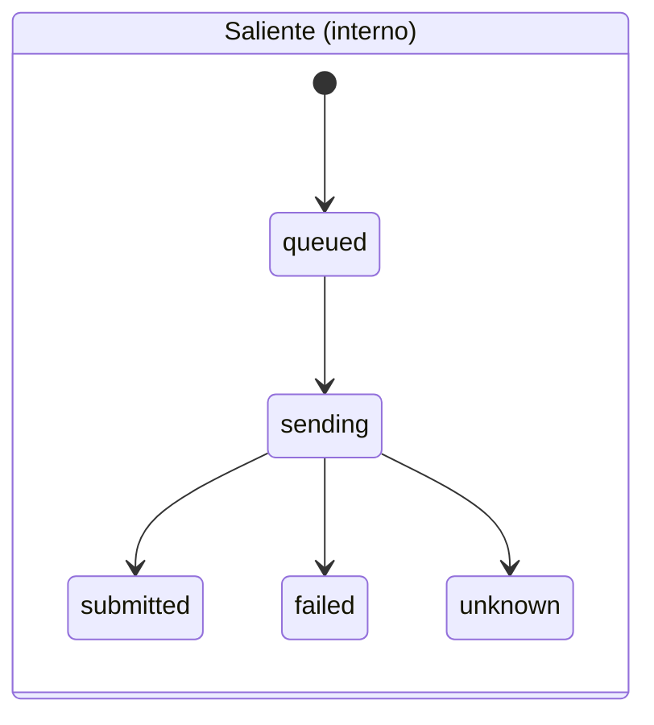
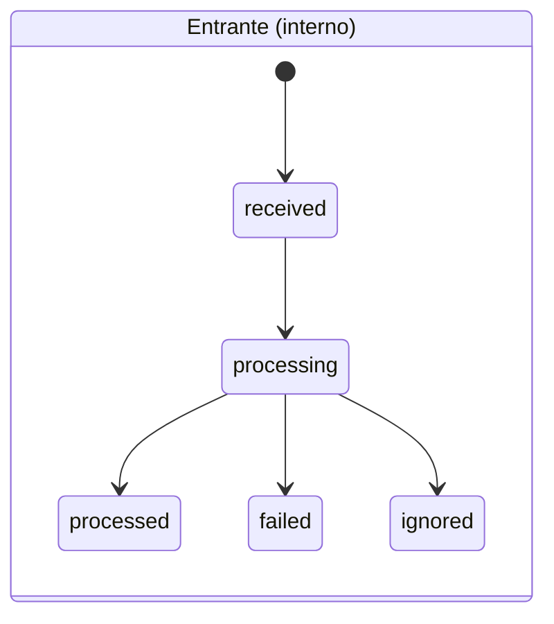
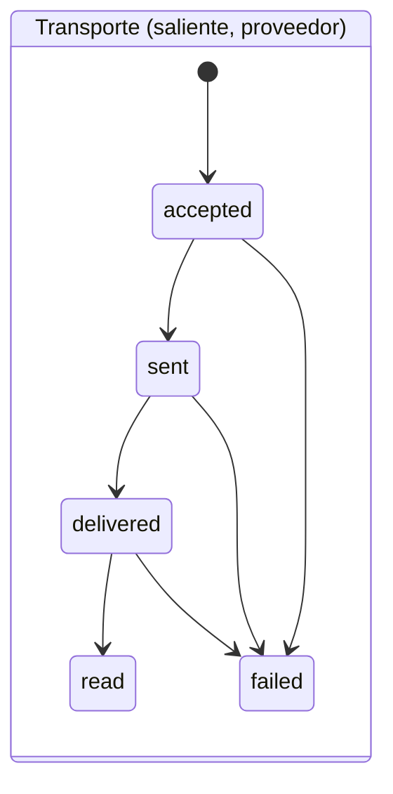
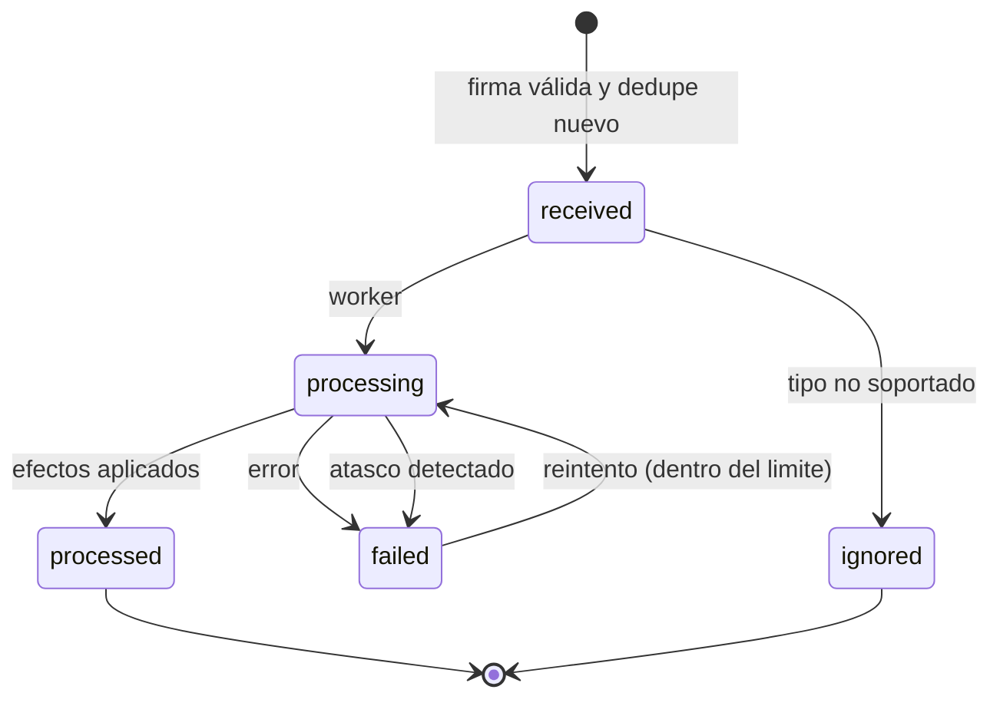

# Máquinas de estados, errores e idempotencia — MVP de Positive

> **Estado:** propuesta de diseño. **No implementado.**
> Fuente principal de estados, transiciones y política de errores. Los valores aquí definidos son los que
> referencian [`data-model.md`](data-model.md) y [`../security/permission-matrix.md`](../security/permission-matrix.md).
> Decisiones sin aprobar en [`design-decisions-pending.md`](design-decisions-pending.md).

## 1. Principios

- Se modelan **tres máquinas independientes**: conversación, mensaje y evento externo. No se comparten estados.
- **Procesamiento interno ≠ transporte del proveedor.** Un mensaje tiene un estado interno y, si es saliente,
  opcionalmente un estado de transporte reportado por el proveedor.
- **Sin evidencia, no hay estado.** Un mensaje no se marca `delivered`/`read` sin notificación del proveedor.
- **No hay exactamente-una-vez.** Se garantiza idempotencia interna; los efectos externos pueden duplicarse.
- **Todo cambio relevante se audita** (`audit_logs`), sin secretos ni contenido de mensajes.

## 2. Máquina de conversación

### 2.1 Significado de los estados

| Estado | Significado operativo |
|---|---|
| `open` | Requiere atención del equipo. Estado por defecto y tras reapertura. |
| `pending` | **En espera de respuesta del cliente o en pausa por el equipo.** Es un estado **operativo**, no una cola técnica ni un mensaje pendiente de envío. **[Provisional — DD-003](design-decisions-pending.md#dd-003).** |
| `resolved` | Atención finalizada por decisión de un usuario autorizado. |

### 2.2 Transiciones permitidas

| Origen | Destino | Quién | Condición | Registro |
|---|---|---|---|---|
| `open` | `pending` | `manager` (admin/agente autorizado) | Conversación visible para el actor | Auditoría `conversation.status_changed` |
| `pending` | `open` | `manager` | Visible para el actor | Auditoría |
| `open` | `resolved` | `manager` | Visible para el actor | Auditoría; fija `resolved_at` |
| `pending` | `resolved` | `manager` | Visible para el actor | Auditoría; fija `resolved_at` |
| `resolved` | `open` | **sistema** | Llega un mensaje entrante nuevo | Auditoría `conversation.reopened`; anula `resolved_at`, `reopened_count++` |
| `resolved` | `open` | `manager` | Reapertura manual autorizada | Auditoría |

Transiciones no listadas se **rechazan** (validación por estado origen con update condicional).

### 2.3 Política de reapertura

- **Un mensaje entrante nuevo a una conversación `resolved` la reabre a `open`** (decisión confirmada por el
  responsable del producto, opción «reabrir la misma conversación»).
- El historial se conserva: no se crea una conversación nueva; se reinicia el ciclo actual
  (`opened_at`, `resolved_at=null`, `reopened_count++`).
- El historial de ciclos vive en `audit_logs`. Una tabla dedicada de transiciones queda **diferida** hasta que la
  analítica por ciclo lo exija.

### 2.4 Diagrama

```mermaid
stateDiagram-v2
    [*] --> open: crear conversación
    open --> pending: manager (en espera/pausa)
    pending --> open: manager (reactivar)
    open --> resolved: manager (finalizar)
    pending --> resolved: manager (finalizar)
    resolved --> open: sistema (mensaje entrante nuevo)\n manager (reapertura manual)
    resolved --> [*]: (no se borra; estado terminal operativo)
```

## 3. Máquina de mensaje

Se separan **dos ejes** que nunca se combinan en un solo campo.

### 3.1 Eje interno (`processing_status`)

**Saliente** (`direction = outbound`):

| Origen | Destino | Disparador |
|---|---|---|
| — | `queued` | Se registra la intención de envío (con `idempotency_key`) |
| `queued` | `sending` | El worker toma el trabajo |
| `sending` | `submitted` | El adaptador confirmó la aceptación (proveedor o simulación) |
| `sending` | `failed` | Error permanente o transitorio agotado |
| `sending` | `unknown` | Se perdió la respuesta; **no se sabe** si el proveedor aceptó |

**Entrante** (`direction = inbound`):

| Origen | Destino | Disparador |
|---|---|---|
| — | `received` | Evento verificado y persistido |
| `received` | `processing` | Comienza el procesamiento de negocio |
| `processing` | `processed` | Efectos aplicados (idempotentes) |
| `processing` | `failed` | Error de procesamiento |
| `processing` | `ignored` | Tipo/evento no soportado de forma deliberada |

`queued`/`sending`/`submitted`/`unknown` **solo** aplican a salientes; `received`/`processing`/`processed`/`failed`/
`ignored` a entrantes. La aplicación valida el conjunto permitido por dirección.

### 3.2 Eje de transporte (`provider_status`, solo saliente, nullable)

| Origen | Destino | Evidencia requerida |
|---|---|---|
| — | `accepted` | Proveedor aceptó el mensaje |
| `accepted` | `sent` | Notificación de envío |
| `sent` | `delivered` | Notificación de entrega |
| `delivered` | `read` | Notificación de lectura |
| cualquiera | `failed` | Notificación de fallo |

- **Monótono:** nunca retrocede. Un evento fuera de orden que no avance se **descarta** para este eje.
- Entrantes: `provider_status` es **nulo** (la entrega es un concepto de salida).
- En mensajes salientes simulados, el estado se marca como **simulado** y no se presenta como real.

### 3.3 Diagramas

> Un mensaje puede estar `processing_status = submitted` con `provider_status` nulo (aún sin evidencia) y pasar a
> `sent`/`delivered` después. Son ejes distintos.

## 4. Máquina de evento externo

### 4.1 Estados

| Estado | Significado |
|---|---|
| `received` | Persistido tras verificar firma; aún no procesado |
| `processing` | Un worker lo está procesando |
| `processed` | Efectos aplicados (idempotentes) |
| `failed` | Falló el procesamiento; puede reintentar según política |
| `ignored` | Evento válido pero sin efecto de negocio (p. ej. tipo no soportado) |

### 4.2 Transiciones

| Origen | Destino | Condición |
|---|---|---|
| `received` | `processing` | Worker toma el evento (marca `processing_started_at`) |
| `processing` | `processed` | Efectos aplicados; marca `processed_at` |
| `processing` | `failed` | Error; incrementa `attempts`, guarda `last_error` |
| `received` | `ignored` | Tipo deliberadamente no soportado |
| `failed` | `processing` | Reintento permitido y con intentos disponibles |
| `processing` | `failed` | Detección de **atasco** (`processing_started_at` antiguo) |

### 4.3 Deduplicación y efecto único

- **Recepción:** al llegar el evento, se verifica la **firma** y se calcula su identidad
  (`external_event_id` si existe; si no, `dedupe_hash`). Si ya existe, se descarta la recepción (no se crea otro
  registro ni se reprocesa).
- **Efecto:** aun descartándose la recepción, los efectos son **idempotentes** y no dependen solo del hash: aplicar
  un estado que no avanza es un no-op.
- **Eventos fuera de orden:** en el eje de transporte, se descartan si no avanzan (monotonía). En conversaciones,
  un entrante `resolved` reabre (efecto definido).
- **Atascos:** un evento en `processing` con `processing_started_at` anterior al umbral se marca `failed` para
  revisión/reintento.

### 4.4 Diagrama

## 5. Política de errores, reintentos e idempotencia

### 5.1 Clasificación de errores de envío

| Clase | Ejemplo | Acción | `processing_status` |
|---|---|---|---|
| **Rechazo confirmado** | Petición inválida, destinatario no permitido confirmado | No reintentar | `failed` |
| **Transitorio** | Timeout, 5xx, límite temporal | Reintentar con backoff, **límite acotado** | `sending` → reintento |
| **Permanente** | Error de cuenta/número, plantilla inexistente | No reintentar | `failed` |
| **Incierto** | Se perdió la respuesta; no se sabe si se aceptó | **No reenviar automáticamente**; reconciliar/alerta | `unknown` |

### 5.2 Claves de deduplicación e idempotencia

| Ámbito | Clave | Naturaleza |
|---|---|---|
| Envío saliente (interno) | `messages.idempotency_key` (UUID) | Propia, fiable |
| Deduplicación de webhooks | `webhook_events.external_event_id` o `dedupe_hash` | Depende del proveedor / canónica |
| Identificador externo de mensaje | `messages.provider_message_id` | Del proveedor, cuando existe |
| Idempotencia de API saliente | Clave enviada por el cliente al endpoint de envío | Propia; evita duplicar por reintento de red |

- **No se promete exactamente-una-vez.** En un resultado incierto puede existir un duplicado real en WhatsApp.
- Los **efectos internos** (actualizar estado, auditoría) sí son idempotentes y no se aplican dos veces.

### 5.3 Reintentos

- **Alcance:** mínimo, no una plataforma genérica. Cola de Laravel con `attempts` acotado y *backoff* exponencial.
- **Máximo de intentos:** valor concreto a fijar por configuración (propuesta: 3) — [DD-012](design-decisions-pending.md#dd-012).
- **No se reintenta automáticamente** en: rechazo confirmado, error permanente, **resultado incierto**.
- **Dead-letter:** los trabajos agotados quedan en `failed_jobs`; requiere revisión manual y auditoría.
- **Detección de atascos:** por `processing_started_at` / `last_error_at` antiguos; alerta operativa.

### 5.4 Resultado incierto (garantías reales)

- La garantía disponible hoy es: **no duplicar efectos internos** y **no reenviar a ciegas**.
- La capacidad de reconciliar (consultar al proveedor por `provider_message_id`) **depende del modo de integración**,
  aún no confirmado ([DD-011](design-decisions-pending.md#dd-011)). Hasta entonces, el caso incierto se marca
  `unknown` y queda para revisión humana. **No se inventa** un mecanismo del proveedor.

## 6. Garantías y limitaciones (proporcional al monolito Laravel)

- **Garantizado:** dedupe de recepción de webhooks, efectos de negocio idempotentes, monotonía de estados de
  transporte, auditoría de acciones, sin exactamente-una-vez, sin infraestructura distribuida.
- **No garantizado:** entrega única al proveedor, orden temporal estricto entre proveedor y sistema, ausencia de
  falsos positivos/negativos en `dedupe_hash`.
- **Límites:** la lista de estados debe ser flexible (validación en aplicación); los umbrales de reintento/atasco
  son configurables y quedan por aprobar.

## 7. Referencias

- Modelo y columnas: [`data-model.md`](data-model.md).
- Permisos por rol y visibilidad: [`../security/permission-matrix.md`](../security/permission-matrix.md).
- Decisiones abiertas: [`design-decisions-pending.md`](design-decisions-pending.md).
- Integración con Meta (bloqueante para el número real): [`../integrations/meta-integration-pending.md`](../integrations/meta-integration-pending.md).
